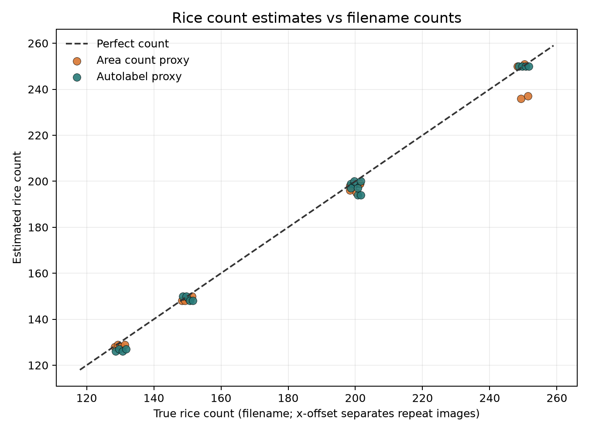
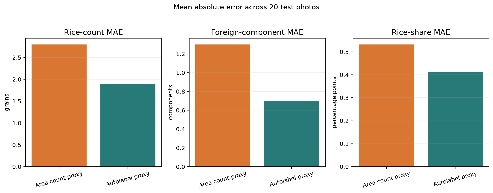
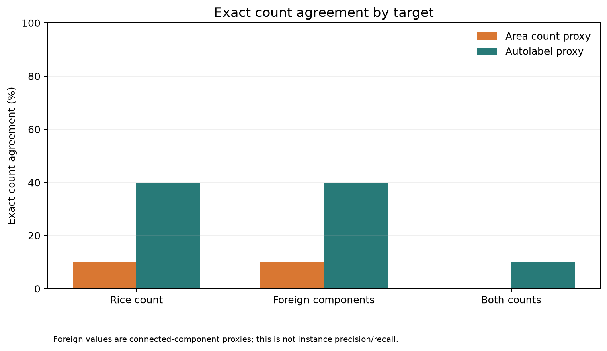
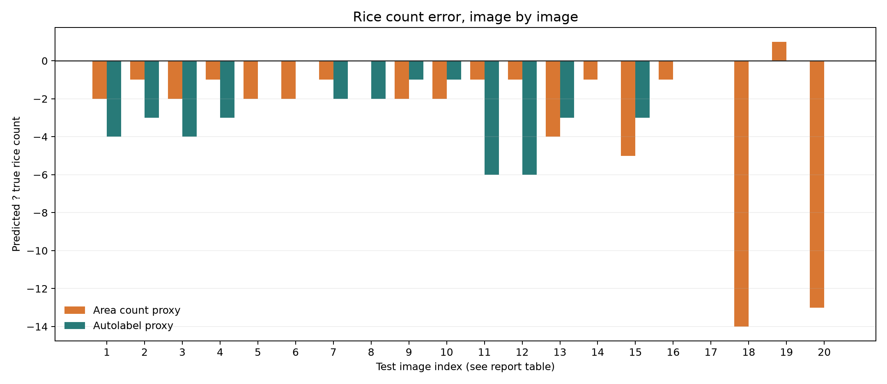
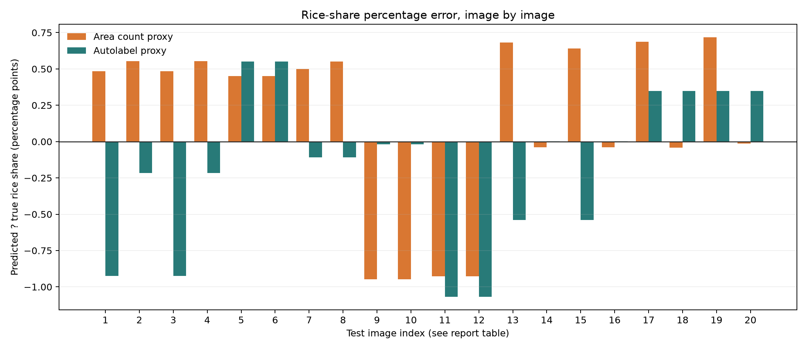

# Area-count and autolabel-proxy test report: 20 images

**Generated:** 2026-10-23  
**Evaluation status:** Experimental proxy-method comparison. These runs do not train a model.

## Summary

Both methods processed the same 20 filename-counted test photos. Rice truth is whole plus broken from the filename; stone truth is the named physical stone count.

| Method | Exact rice count | Rice MAE | Rice RMSE | Rice MAPE | Exact foreign-component count | Foreign-component MAE | Both counts exact |
|---|---:|---:|---:|---:|---:|---:|---:|
| Area count proxy | 2/20 (10.00%) | 2.80 | 4.68 | 1.38% | 2/20 (10.00%) | 1.30 | 0/20 |
| Autolabel proxy | 8/20 (40.00%) | 1.90 | 2.74 | 1.17% | 8/20 (40.00%) | 0.70 | 2/20 |

The autolabel proxy has the lower rice-count MAE on these 20 images. The area proxy has two larger undercounts in the 250-rice group. Treat this as performance on this small set of controlled compositions, not proof of generalization to new compositions or capture conditions.

## Test set

There are 20 images: four per filename-derived composition. The filename provides image-level counts, not annotated grain/stone masks.

| True rice / stones | n | Area rice MAE | Autolabel rice MAE | Area exact rice | Autolabel exact rice |
|---|---:|---:|---:|---:|---:|
| 130 / 15 | 4 | 1.50 | 3.50 | 0/4 | 0/4 |
| 150 / 15 | 4 | 1.25 | 1.00 | 1/4 | 2/4 |
| 200 / 10 | 4 | 1.50 | 3.50 | 0/4 | 0/4 |
| 200 / 20 | 4 | 2.75 | 1.50 | 0/4 | 2/4 |
| 250 / 20 | 4 | 7.00 | 0.00 | 1/4 | 4/4 |

## Methods

### Area-count proxy

Images are resized to a 1536-pixel long side. A Lab-colour mask estimates foreground by comparing pixels with a local background estimate. The method separates dark/orange stone pixels and remaining rice pixels. Rice count is estimated from total rice-mask area divided by a single-grain area and an area-bias calibration. The current calibration uses 388 reference photos assumed to have 100 rice each, bias 0.984, and a fallback grain area of 1,483 pixels. For the test images, the per-photo lone-grain area was used where available. The reported foreign count is the number of connected components, not guaranteed one count per physical stone.

### Autolabel proxy

The fixed HSV rule removes green background (hue 55 to 100 and saturation above 90), classifies orange/tan or very dark foreground as foreign matter, and treats remaining foreground as rice. It estimates a single-grain reference area from rice components and splits large components into a rounded estimated grain count using fixed-seed KMeans on pixel coordinates. Foreign matter is counted as connected stone-mask blobs. It is a rule-based proxy, not a trained model; its instance outlines are not independently verified.

## Metrics and interpretation

- Exact count agreement is the percent of images where the numeric count equals the filename count. It is not object detection accuracy.
- MAE is the average absolute count error; RMSE penalizes larger errors more.
- MAPE is the mean of per-image absolute percentage errors. WAPE divides total absolute error by total true count.
- Mean signed error is predicted minus true; a negative value means undercounting.
- R2 describes variation across the full target range and can be negative. Here, broad differences between composition groups can make R2 high even when some individual counts are off; use exact-match rate and MAE alongside it.
- Foreign-component metrics compare connected mask blobs to the number of physical stones and are only proxy agreement. Touching stones may merge.
- The test set contains four images per composition, so multiple photos share the same count composition.

### Rice-count metrics

| Method | Exact | Within 1 | Within 2 | Within 5% | MAE (grains) | RMSE (grains) | Median AE | MAPE | WAPE | Bias | R2 |
|---|---:|---:|---:|---:|---:|---:|---:|---:|---:|---:|---:|
| Area count proxy | 10.00% | 50.00% | 80.00% | 90.00% | 2.80 | 4.68 | 1.50 | 1.38% | 1.51% | -2.70 | 0.988 |
| Autolabel proxy | 40.00% | 50.00% | 60.00% | 100.00% | 1.90 | 2.74 | 1.50 | 1.17% | 1.02% | -1.90 | 0.996 |

### Foreign-component metrics vs physical stone counts

| Method | Exact | Within 1 | Within 2 | Within 5% | MAE (components) | RMSE (components) | Median AE | MAPE | WAPE | Bias | R2 |
|---|---:|---:|---:|---:|---:|---:|---:|---:|---:|---:|---:|
| Area count proxy | 10.00% | 60.00% | 100.00% | 20.00% | 1.30 | 1.45 | 1.00 | 9.17% | 8.12% | -0.50 | 0.850 |
| Autolabel proxy | 40.00% | 90.00% | 100.00% | 70.00% | 0.70 | 0.95 | 1.00 | 4.83% | 4.38% | 0.10 | 0.936 |

### Rice-share percentage error

Rice share is predicted rice divided by predicted rice plus predicted foreign components. The reference is true rice divided by rice plus physical stones. A foreign blob may not equal a physical stone.

| Method | Share MAE (percentage points) | Share RMSE | Mean signed share error |
|---|---:|---:|---:|
| Area count proxy | 0.53 | 0.61 | 0.14 |
| Autolabel proxy | 0.41 | 0.54 | -0.16 |

### Precision, recall and F1

Object-level precision, recall and F1 cannot be calculated from these filenames alone. Those metrics require per-object ground-truth masks or identities to match predicted grains and stones to true objects. This dataset supports count error and exact count agreement only. Instance-level rice/foreign classification accuracy is likewise undetermined.

## Per-image results

Count error is predicted count minus true count. Foreign outputs are connected-component counts. Percentage values show the estimated rice share and its signed difference in percentage points (pp) from the filename-derived ratio.

| # | Test image | True rice | Area rice (error) | Autolabel rice (error) | True stones | Area components (error) | Autolabel components (error) | True rice share | Area share | Autolabel share |
|---:|---|---:|---:|---:|---:|---:|---:|---:|---:|---:|
| 01 | 115 whole, 15 broken , 15 stones(1).jpg | 130 | 128 (-2) | 126 (-4) | 15 | 14 (-1) | 16 (+1) | 89.66% | 90.14% (+0.48 pp) | 88.73% (-0.93 pp) |
| 02 | 115 whole, 15 broken , 15 stones(2).jpg | 130 | 129 (-1) | 127 (-3) | 15 | 14 (-1) | 15 (+0) | 89.66% | 90.21% (+0.55 pp) | 89.44% (-0.22 pp) |
| 03 | 115 whole, 15 broken , 15 stones(3).jpg | 130 | 128 (-2) | 126 (-4) | 15 | 14 (-1) | 16 (+1) | 89.66% | 90.14% (+0.48 pp) | 88.73% (-0.93 pp) |
| 04 | 115 whole, 15 broken , 15 stones.jpg | 130 | 129 (-1) | 127 (-3) | 15 | 14 (-1) | 15 (+0) | 89.66% | 90.21% (+0.55 pp) | 89.44% (-0.22 pp) |
| 05 | 135 whole , 15 broken , 15 stones(1).jpg | 150 | 148 (-2) | 150 (+0) | 15 | 14 (-1) | 14 (-1) | 90.91% | 91.36% (+0.45 pp) | 91.46% (+0.55 pp) |
| 06 | 135 whole , 15 broken , 15 stones(2).jpg | 150 | 148 (-2) | 150 (+0) | 15 | 14 (-1) | 14 (-1) | 90.91% | 91.36% (+0.45 pp) | 91.46% (+0.55 pp) |
| 07 | 135 whole , 15 broken , 15 stones(3).jpg | 150 | 149 (-1) | 148 (-2) | 15 | 14 (-1) | 15 (+0) | 90.91% | 91.41% (+0.50 pp) | 90.80% (-0.11 pp) |
| 08 | 135 whole , 15 broken , 15 stones.jpg | 150 | 150 (+0) | 148 (-2) | 15 | 14 (-1) | 15 (+0) | 90.91% | 91.46% (+0.55 pp) | 90.80% (-0.11 pp) |
| 09 | 185 whole, 15 broken, 10 stones(1).jpg | 200 | 198 (-2) | 199 (-1) | 10 | 12 (+2) | 10 (+0) | 95.24% | 94.29% (-0.95 pp) | 95.22% (-0.02 pp) |
| 10 | 185 whole, 15 broken, 10 stones(2).jpg | 200 | 198 (-2) | 199 (-1) | 10 | 12 (+2) | 10 (+0) | 95.24% | 94.29% (-0.95 pp) | 95.22% (-0.02 pp) |
| 11 | 185 whole, 15 broken, 10 stones(3).jpg | 200 | 199 (-1) | 194 (-6) | 10 | 12 (+2) | 12 (+2) | 95.24% | 94.31% (-0.93 pp) | 94.17% (-1.07 pp) |
| 12 | 185 whole, 15 broken, 10 stones.jpg | 200 | 199 (-1) | 194 (-6) | 10 | 12 (+2) | 12 (+2) | 95.24% | 94.31% (-0.93 pp) | 94.17% (-1.07 pp) |
| 13 | 185 whole, 15 broken, 20 stones(1).jpg | 200 | 196 (-4) | 197 (-3) | 20 | 18 (-2) | 21 (+1) | 90.91% | 91.59% (+0.68 pp) | 90.37% (-0.54 pp) |
| 14 | 185 whole, 15 broken, 20 stones(2).jpg | 200 | 199 (-1) | 200 (+0) | 20 | 20 (+0) | 20 (+0) | 90.91% | 90.87% (-0.04 pp) | 90.91% (+0.00 pp) |
| 15 | 185 whole, 15 broken, 20 stones(3).jpg | 200 | 195 (-5) | 197 (-3) | 20 | 18 (-2) | 21 (+1) | 90.91% | 91.55% (+0.64 pp) | 90.37% (-0.54 pp) |
| 16 | 185 whole, 15 broken, 20 stones.jpg | 200 | 199 (-1) | 200 (+0) | 20 | 20 (+0) | 20 (+0) | 90.91% | 90.87% (-0.04 pp) | 90.91% (+0.00 pp) |
| 17 | 235 whole, 15 broken , 20 stones(1).jpg | 250 | 250 (+0) | 250 (+0) | 20 | 18 (-2) | 19 (-1) | 92.59% | 93.28% (+0.69 pp) | 92.94% (+0.35 pp) |
| 18 | 235 whole, 15 broken , 20 stones(2).jpg | 250 | 236 (-14) | 250 (+0) | 20 | 19 (-1) | 19 (-1) | 92.59% | 92.55% (-0.04 pp) | 92.94% (+0.35 pp) |
| 19 | 235 whole, 15 broken , 20 stones(3).jpg | 250 | 251 (+1) | 250 (+0) | 20 | 18 (-2) | 19 (-1) | 92.59% | 93.31% (+0.72 pp) | 92.94% (+0.35 pp) |
| 20 | 235 whole, 15 broken , 20 stones.jpg | 250 | 237 (-13) | 250 (+0) | 20 | 19 (-1) | 19 (-1) | 92.59% | 92.58% (-0.01 pp) | 92.94% (+0.35 pp) |

# Shared presentation figures

## Per-method graphs

#### Area count proxy

#### Autolabel proxy

## Artifacts

- Area-count raw output, normalized per-image metrics, summary metrics, graphs and overlays: [area-count results](../rice_count_pipeline/methods/area_count/results/test_set/)
- Autolabel raw output, normalized per-image metrics, summary metrics, graphs and overlays: [autolabel results](../rice_count_pipeline/methods/autolabel_proxy/results/test_set/)
- Shared comparison graphs: [comparison figures](figures/area_autolabel_test/)
