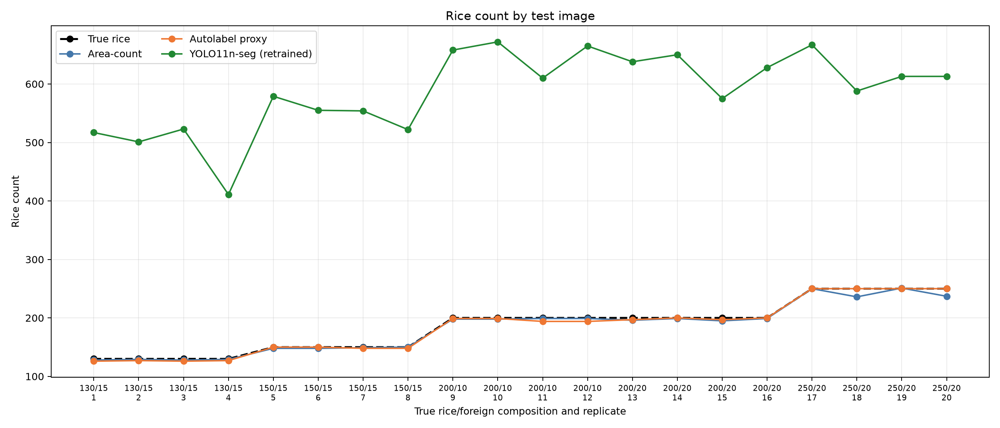
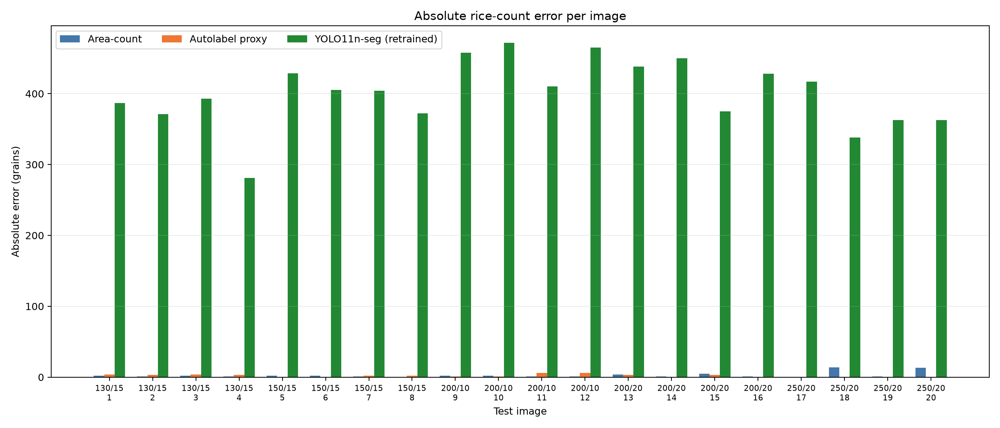
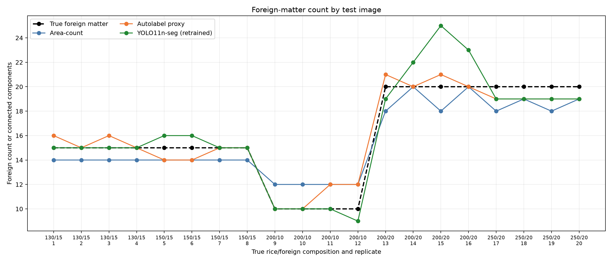
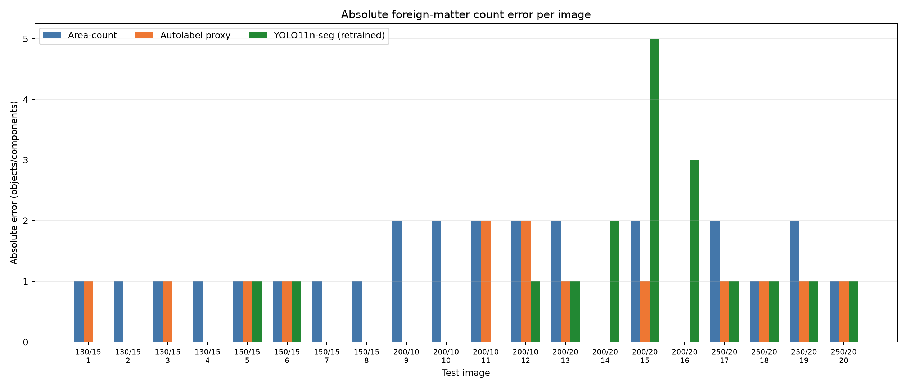
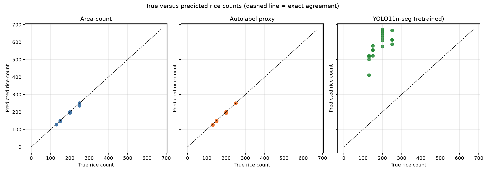
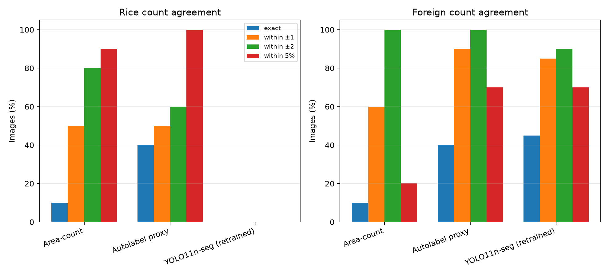
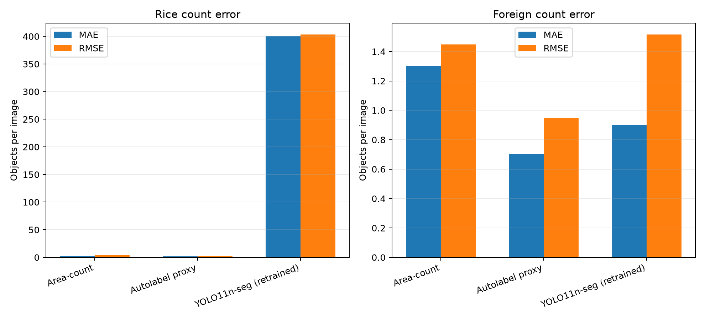
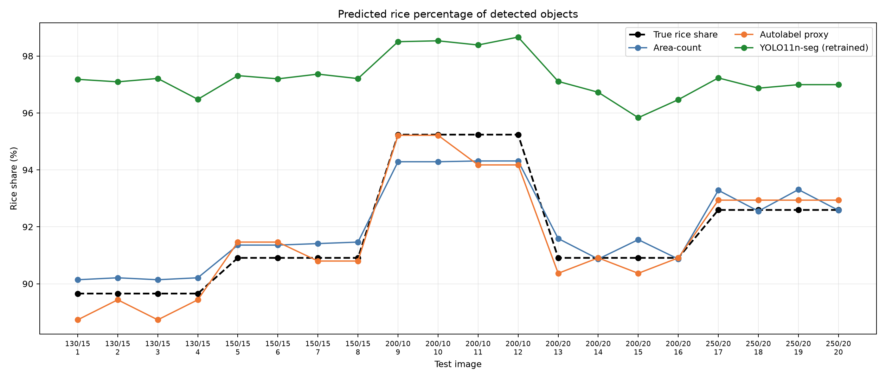
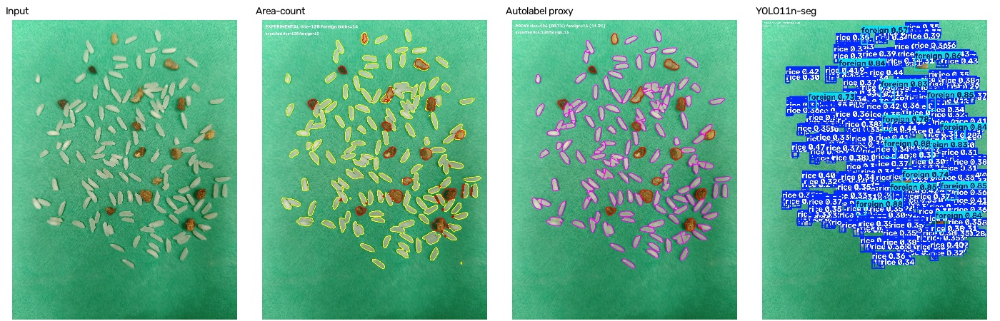
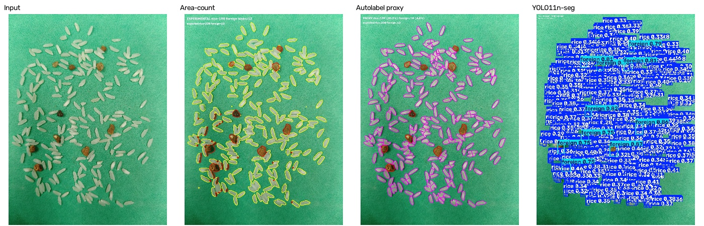

# Three-method test comparison: rice and foreign-matter counts

## Scope and data

Compared the **area-count**, **autolabel proxy**, and **retrained YOLO11n-seg** methods on the same 20 held-out test photos. Truth is parsed from each filename; test photos cover rice/foreign compositions from 130/15 through 250/20. The training photos are the 860 images in `A:\grain\data\rice_count\raw`.

The YOLO model trained for **20 epochs at 640 px**, batch 2, on all 860 photos, using the autolabel proxy masks. Test inference used 512 px and `max_det=3000` to fit the 6 GB GPU while avoiding Ultralytics' low default detection caps. There is no independent validation split: the final mask mAP50 below is an **in-sample fit to those same proxy masks**. Overall mask mAP50: **0.5764**; rice class: **0.2123**; foreign class: **0.9405**. This is not ground-truth test accuracy.

The proxy-label audit found rice pseudo-counts min/median/max **97/103/2464**, with **388/860** outside 99–105; foreign pseudo-counts min/median/max **6/10/12**, with **298/860** not equal to 10. These are noisy auto-labels, and the trained model can inherit those errors. All 860 source photos were retained; no photo was filtered by its pseudo-count.

## Methods compared

- **Area-count:** estimate rice count by dividing segmented rice foreground area by a per-photo single-grain area estimate (or a training-set fallback), adjusted by a calibration bias. Foreign matter is counted as connected stone blobs. It estimates counts from aggregate area; it does not detect each grain instance.
- **Autolabel proxy:** threshold foreground and stone pixels by HSV color, count foreign connected components, and estimate rice instances from connected-component areas. Large rice clumps are split into spatial clusters with KMeans. This is a rule-based labeler, not a trained model.
- **YOLO11n-seg:** trained on all 860 raw photos with the proxy's rice/foreign polygons as pseudo instance masks. It predicts segmented instances and counts class detections. Because training targets are generated by the proxy, it can learn proxy errors; its training mAP is not an independent accuracy result.

## Count metrics

Errors are predicted minus true counts. Exact rate and tolerance rates are percentages of images. MAPE is mean per-image absolute percentage error; WAPE is total absolute error divided by total truth; R² describes count fit and is not a classification accuracy. Foreign outputs from the two classical methods are connected-component counts, not verified one-component-per-stone measurements.

| Method | Class | MAE | RMSE | Median AE | MAPE | WAPE | Bias | R² | Exact | Within ±1 | Within ±2 | Within 5% |
|---|---|---:|---:|---:|---:|---:|---:|---:|---:|---:|---:|---:|
| Area-count | rice | 2.80 | 4.68 | 1.50 | 1.38% | 1.51% | -2.70 | 0.9877 | 10.0% | 50.0% | 80.0% | 90.0% |
| Area-count | foreign | 1.30 | 1.45 | 1.00 | 9.17% | 8.12% | -0.50 | 0.8500 | 10.0% | 60.0% | 100.0% | 20.0% |
| Autolabel proxy | rice | 1.90 | 2.74 | 1.50 | 1.17% | 1.02% | -1.90 | 0.9958 | 40.0% | 50.0% | 60.0% | 100.0% |
| Autolabel proxy | foreign | 0.70 | 0.95 | 1.00 | 4.83% | 4.38% | +0.10 | 0.9357 | 40.0% | 90.0% | 100.0% | 70.0% |
| YOLO11n-seg (retrained) | rice | 400.95 | 403.56 | 404.50 | 225.76% | 215.56% | +400.95 | -90.2888 | 0.0% | 0.0% | 0.0% | 0.0% |
| YOLO11n-seg (retrained) | foreign | 0.90 | 1.52 | 1.00 | 4.92% | 5.62% | +0.30 | 0.8357 | 45.0% | 85.0% | 90.0% | 70.0% |

### Exact-match summary

- **Area-count:** 0/20 both counts exact; rice 2/20 exact; foreign 2/20 exact.
- **Autolabel proxy:** 2/20 both counts exact; rice 8/20 exact; foreign 8/20 exact.
- **YOLO11n-seg (retrained):** 0/20 both counts exact; rice 0/20 exact; foreign 9/20 exact.

### Percentage-share error

Rice share error is the predicted rice percentage minus the true rice percentage, measured in percentage points:

| Method | Share MAE (pp) | Share RMSE (pp) | Median AE (pp) | Share bias (pp) |
|---|---:|---:|---:|---:|
| Area-count | 0.533 | 0.610 | 0.554 | +0.143 |
| Autolabel proxy | 0.412 | 0.537 | 0.344 | -0.164 |
| YOLO11n-seg (retrained) | 5.407 | 5.597 | 5.687 | +5.407 |

## Every test image: counts

Each prediction cell shows `predicted (signed error)`. For example, `128 (-2)` means 128 predicted against the filename truth, under by 2.

| Test image | True rice / foreign | Area rice (Δ) | Area foreign (Δ) | Proxy rice (Δ) | Proxy foreign (Δ) | YOLO rice (Δ) | YOLO foreign (Δ) |
|---|---:|---:|---:|---:|---:|---:|---:|
| 115 whole, 15 broken , 15 stones(1).jpg | 130 / 15 | 128 (-2) | 14 (-1) | 126 (-4) | 16 (+1) | 517 (+387) | 15 (+0) |
| 115 whole, 15 broken , 15 stones(2).jpg | 130 / 15 | 129 (-1) | 14 (-1) | 127 (-3) | 15 (+0) | 501 (+371) | 15 (+0) |
| 115 whole, 15 broken , 15 stones(3).jpg | 130 / 15 | 128 (-2) | 14 (-1) | 126 (-4) | 16 (+1) | 523 (+393) | 15 (+0) |
| 115 whole, 15 broken , 15 stones.jpg | 130 / 15 | 129 (-1) | 14 (-1) | 127 (-3) | 15 (+0) | 411 (+281) | 15 (+0) |
| 135 whole , 15 broken , 15 stones(1).jpg | 150 / 15 | 148 (-2) | 14 (-1) | 150 (+0) | 14 (-1) | 579 (+429) | 16 (+1) |
| 135 whole , 15 broken , 15 stones(2).jpg | 150 / 15 | 148 (-2) | 14 (-1) | 150 (+0) | 14 (-1) | 555 (+405) | 16 (+1) |
| 135 whole , 15 broken , 15 stones(3).jpg | 150 / 15 | 149 (-1) | 14 (-1) | 148 (-2) | 15 (+0) | 554 (+404) | 15 (+0) |
| 135 whole , 15 broken , 15 stones.jpg | 150 / 15 | 150 (+0) | 14 (-1) | 148 (-2) | 15 (+0) | 522 (+372) | 15 (+0) |
| 185 whole, 15 broken, 10 stones(1).jpg | 200 / 10 | 198 (-2) | 12 (+2) | 199 (-1) | 10 (+0) | 658 (+458) | 10 (+0) |
| 185 whole, 15 broken, 10 stones(2).jpg | 200 / 10 | 198 (-2) | 12 (+2) | 199 (-1) | 10 (+0) | 672 (+472) | 10 (+0) |
| 185 whole, 15 broken, 10 stones(3).jpg | 200 / 10 | 199 (-1) | 12 (+2) | 194 (-6) | 12 (+2) | 610 (+410) | 10 (+0) |
| 185 whole, 15 broken, 10 stones.jpg | 200 / 10 | 199 (-1) | 12 (+2) | 194 (-6) | 12 (+2) | 665 (+465) | 9 (-1) |
| 185 whole, 15 broken, 20 stones(1).jpg | 200 / 20 | 196 (-4) | 18 (-2) | 197 (-3) | 21 (+1) | 638 (+438) | 19 (-1) |
| 185 whole, 15 broken, 20 stones(2).jpg | 200 / 20 | 199 (-1) | 20 (+0) | 200 (+0) | 20 (+0) | 650 (+450) | 22 (+2) |
| 185 whole, 15 broken, 20 stones(3).jpg | 200 / 20 | 195 (-5) | 18 (-2) | 197 (-3) | 21 (+1) | 575 (+375) | 25 (+5) |
| 185 whole, 15 broken, 20 stones.jpg | 200 / 20 | 199 (-1) | 20 (+0) | 200 (+0) | 20 (+0) | 628 (+428) | 23 (+3) |
| 235 whole, 15 broken , 20 stones(1).jpg | 250 / 20 | 250 (+0) | 18 (-2) | 250 (+0) | 19 (-1) | 667 (+417) | 19 (-1) |
| 235 whole, 15 broken , 20 stones(2).jpg | 250 / 20 | 236 (-14) | 19 (-1) | 250 (+0) | 19 (-1) | 588 (+338) | 19 (-1) |
| 235 whole, 15 broken , 20 stones(3).jpg | 250 / 20 | 251 (+1) | 18 (-2) | 250 (+0) | 19 (-1) | 613 (+363) | 19 (-1) |
| 235 whole, 15 broken , 20 stones.jpg | 250 / 20 | 237 (-13) | 19 (-1) | 250 (+0) | 19 (-1) | 613 (+363) | 19 (-1) |

## Every test image: predicted composition

Percentages are the method's predicted rice and foreign counts divided by its total predicted count. These are composition-share metrics, not pixel-area percentages.

| Test image | True rice / foreign % | Area rice / foreign % | Proxy rice / foreign % | YOLO rice / foreign % |
|---|---:|---:|---:|---:|
| 115 whole, 15 broken , 15 stones(1).jpg | 89.66 / 10.34 | 90.14 / 9.86 | 88.73 / 11.27 | 97.18 / 2.82 |
| 115 whole, 15 broken , 15 stones(2).jpg | 89.66 / 10.34 | 90.21 / 9.79 | 89.44 / 10.56 | 97.09 / 2.91 |
| 115 whole, 15 broken , 15 stones(3).jpg | 89.66 / 10.34 | 90.14 / 9.86 | 88.73 / 11.27 | 97.21 / 2.79 |
| 115 whole, 15 broken , 15 stones.jpg | 89.66 / 10.34 | 90.21 / 9.79 | 89.44 / 10.56 | 96.48 / 3.52 |
| 135 whole , 15 broken , 15 stones(1).jpg | 90.91 / 9.09 | 91.36 / 8.64 | 91.46 / 8.54 | 97.31 / 2.69 |
| 135 whole , 15 broken , 15 stones(2).jpg | 90.91 / 9.09 | 91.36 / 8.64 | 91.46 / 8.54 | 97.20 / 2.80 |
| 135 whole , 15 broken , 15 stones(3).jpg | 90.91 / 9.09 | 91.41 / 8.59 | 90.80 / 9.20 | 97.36 / 2.64 |
| 135 whole , 15 broken , 15 stones.jpg | 90.91 / 9.09 | 91.46 / 8.54 | 90.80 / 9.20 | 97.21 / 2.79 |
| 185 whole, 15 broken, 10 stones(1).jpg | 95.24 / 4.76 | 94.29 / 5.71 | 95.22 / 4.78 | 98.50 / 1.50 |
| 185 whole, 15 broken, 10 stones(2).jpg | 95.24 / 4.76 | 94.29 / 5.71 | 95.22 / 4.78 | 98.53 / 1.47 |
| 185 whole, 15 broken, 10 stones(3).jpg | 95.24 / 4.76 | 94.31 / 5.69 | 94.17 / 5.83 | 98.39 / 1.61 |
| 185 whole, 15 broken, 10 stones.jpg | 95.24 / 4.76 | 94.31 / 5.69 | 94.17 / 5.83 | 98.66 / 1.34 |
| 185 whole, 15 broken, 20 stones(1).jpg | 90.91 / 9.09 | 91.59 / 8.41 | 90.37 / 9.63 | 97.11 / 2.89 |
| 185 whole, 15 broken, 20 stones(2).jpg | 90.91 / 9.09 | 90.87 / 9.13 | 90.91 / 9.09 | 96.73 / 3.27 |
| 185 whole, 15 broken, 20 stones(3).jpg | 90.91 / 9.09 | 91.55 / 8.45 | 90.37 / 9.63 | 95.83 / 4.17 |
| 185 whole, 15 broken, 20 stones.jpg | 90.91 / 9.09 | 90.87 / 9.13 | 90.91 / 9.09 | 96.47 / 3.53 |
| 235 whole, 15 broken , 20 stones(1).jpg | 92.59 / 7.41 | 93.28 / 6.72 | 92.94 / 7.06 | 97.23 / 2.77 |
| 235 whole, 15 broken , 20 stones(2).jpg | 92.59 / 7.41 | 92.55 / 7.45 | 92.94 / 7.06 | 96.87 / 3.13 |
| 235 whole, 15 broken , 20 stones(3).jpg | 92.59 / 7.41 | 93.31 / 6.69 | 92.94 / 7.06 | 96.99 / 3.01 |
| 235 whole, 15 broken , 20 stones.jpg | 92.59 / 7.41 | 92.58 / 7.42 | 92.94 / 7.06 | 96.99 / 3.01 |

## Training-set agreement with proxy counts

On the same 860 training images, predicted counts versus proxy counts had rice MAE 208.54 and foreign MAE 0.38; 6.9% were within rice ±3 and foreign ±1. This is in-sample proxy agreement, not ground-truth accuracy.

## Visual inspection

The panels use the same input image for every method in each row; the overlays are saved in each method's own `results/test_set` folder.

## Interpretation and metric limits

- The filename provides only total rice and foreign counts. There are no test-time per-object ground-truth masks or matched object identities, so **object precision, object recall, object F1, and instance-level mask IoU are not measurable** from this test set. Count exact rate is not object-detection precision.
- Training on one near-constant composition does not establish generalization to arbitrary counts. The 20 test photos provide a count-level check for five filename-defined rice/foreign combinations from 130/15 to 250/20; a broader held-out set with varied counts and arrangements is needed before claiming reliable performance on new compositions.
- YOLO's mAP50 is reported against pseudo-label masks on the training images, not the 20 test-image filename totals. Use the per-image count table and test metrics above to compare actual count behavior.

## Files

- Combined report: `docs/three_method_test_report.md`
- Combined per-image and summary CSVs: `docs/results/three_method_test/`
- Comparison graphs: `docs/figures/three_method_test/`
- Area-count results, graphs and overlays: `rice_count_pipeline/methods/area_count/results/test_set/`
- Autolabel proxy results, graphs and overlays: `rice_count_pipeline/methods/autolabel_proxy/results/test_set/`
- YOLO results, graphs, box overlays and mask overlays: `rice_count_pipeline/methods/weak_count_model/results/test_set/`
- Trained weights: `models/experiments/weak_count_model/weak_count.pt`
