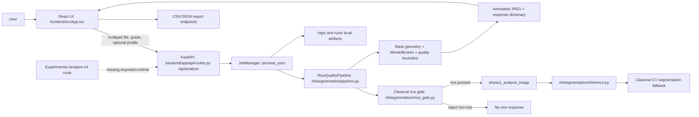

# Grain Quality Analyzer — Project Overview

Audit date: 2026-10-21 (workspace state inspected on this date).

## Purpose and current status

This repository contains a React/TypeScript web UI and a FastAPI/Python API for image-based rice-grain analysis. The implemented application accepts an image, applies a classical-CV rice/non-rice gate, segments candidate individual grains, measures their masks, estimates Whole/Broken status, and returns an annotated image and sample summary. Geometry and Whole/Broken are image-derived. Pixel measurements are not physical units unless a valid calibration is supplied; the configured 154.1 px default profile is explicitly a scale-specific proxy.

The current checkout is internally inconsistent. `README.md`, `PROJECT_CONTEXT.md`, and `configs/models.json` describe a classical-CV clean baseline and say model experiments were removed. Current code retains legacy YOLOv8/Mask R-CNN lookup paths, current experimental training scripts exist under `backend/models/`, and an experimental inference route exists. Its imported implementation, `backend.models.grain_infer`, is missing; a similarly named file is under `backend/old models/`. The recent `progress/WORK_LOG.md` entry also describes YOLO26 production integration, but current configuration and source do not implement that integration. Current runtime/source wins: normal analysis uses classical CV in this checkout.

## Verified technology stack

| Area | Current evidence |
|---|---|
| Frontend | React 18 + TypeScript + Vite 6 + Tailwind 3; resolved Vite in the build was 6.4.3. |
| Backend | FastAPI + Pydantic 2 + Uvicorn, Python APIs. Current global Python is 3.14.5; a root `.venv` is Python 3.12.4. |
| Image/CV | OpenCV + NumPy + Pillow; classical foreground extraction, connected components, watershed/pinch splitting, contours and mask geometry. |
| ML tooling | Ultralytics is installed in both inspected environments. The root model environment also has Torch/torchvision. The primary configured segmentation registry remains placeholder. |
| Persistence | No database found. Jobs are held in a process-local dictionary; run artifacts/logs are written to local folders. |

Installed global Python versions observed: FastAPI 0.142.4, Uvicorn 0.54.0, Ultralytics 8.4.171, Torch 2.13.0, torchvision 0.28.0, OpenCV 4.13.0.92, NumPy 2.4.6, Pillow 12.2.0, Pydantic 2.13.5, pytest 9.1.1. Root `.venv` versions differ: Ultralytics 8.4.183, Torch 2.14.1+cu130, torchvision 0.29.1+cu130, OpenCV 5.0.0.93, NumPy 2.5.2, Pillow 12.3.0; FastAPI/Uvicorn/Pydantic/pytest were not installed there. See `TESTING_AND_ENVIRONMENT.md`.

## Architecture and request flow



Normal `/analyze` is one synchronous request handled by an `async` route that directly invokes CPU/GPU-bound `process_sync`; it does not enqueue background work. The manager does create an in-memory job record, but the frontend waits for the complete response and does not poll it. No durable result store exists. Experimental `/analyze-ml` is separate and currently returns 503 because its runtime import/checkpoint cannot initialize.

## Relevant project tree

Generated and dependency trees are summarized rather than expanded. The report directory itself is new for this audit.

```text
.
├── backend/
│   ├── app/{main.py,api/routes.py,schemas/models.py,services/{job_manager.py,run_logger.py,export.py}}
│   ├── models/{autolabel.py,build_dataset.py,train_yolo.py,predict_count.py,evaluate_counts.py}
│   ├── old models/{grain_infer.py,train_yolo.py,train_maskrcnn.py,prepare_data.py,auto_annotate.py,*.md}
│   ├── data/{raw/ [860 JPGs],test/ [empty],work/ [review package and reports],yolo/ [empty]}
│   └── audit outputs, local .venv, and results (generated/ignored)
├── configs/{app,inference,models,parameters,thresholds}.json
├── data/grain/{raw_images,annotations,dataset,overlays}/ [empty directories]
├── docs/{architecture.md,CURRENT_STATUS.md,FULL_PROJECT_EXPLANATION.md,edge-cases.md,cleanup_report.md}
├── frontend/{src/{App.tsx,types.ts,components/},package.json,vite.config.ts}
├── grain_profiles/default_rice.json
├── ml/{segmentation/,quality/,standards/,config.py}
├── models/{segmentation/,foreign_matter/} [class maps only; configured checkpoints absent]
├── monitoring/{app.py,log_parser.py}
├── progress/WORK_LOG.md
├── raw_images/ [4 JPG photos]
├── runs/ and tmp/ [generated experiment artifacts; tmp about 2.7 GiB]
├── scripts/ [profile, validation, and image utility scripts]
├── standards/india_kms_2026_27_raw_rice.json
├── test_images/ [256 images across three validation groups, plus results/artifacts]
├── tests/ [six pytest files and synthetic fixture generator]
├── weights/yolo26n.pt and root yolo11n.pt/yolo11s.pt [generic COCO detection]
└── project_audit/ [this audit]
```

`backend/data/raw/` contains 860 local JPG files (~4.1 GiB); `backend/data/work/review/coco.json` records 2 images, 224 annotations and categories `rice` and `foreign`. This is not a complete reviewed training set or train/validation/test split. `data/grain/` is empty. Test/validation images are not training data by default. The 860 raw photos' provenance and annotation coverage need confirmation.

## Important modules

| File/folder | Responsibility and relationship | Status |
|---|---|---|
| `backend/app/main.py` | FastAPI app, CORS, logging, route registration, static frontend mount; tries to initialize experimental runtime at startup. | Imports successfully; ML runtime import is missing. |
| `backend/app/api/routes.py` | Health, registry, standards, synchronous analyze, experimental analyze, job/result/image/export routes. Router is mounted both under `/api` and root. | Main `/api/analyze` path covered by API tests. |
| `backend/app/services/job_manager.py` | Owns one pipeline instance, runs analysis in-process, keeps job dictionaries in RAM, writes run artifacts. | Not a background queue or durable database. |
| `ml/segmentation/pipeline.py` | Decodes input, runs gate, calibration, Phase-1 mask pipeline, downstream quality metrics, summaries, annotation and serialization. | Current source of primary response behavior. |
| `ml/segmentation/rice_gate.py` | Per-object CV features/classification; optional feature model if configured artifact exists; hard negatives remain non-rice. | Preserve gate semantics; tests cover it. |
| `ml/segmentation/inference.py` | Phase-1 loader checks legacy YOLOv8 and Mask R-CNN configured paths, then uses classical CV. Converts detections to mask polygons. | No configured/available rice checkpoint; fallback is current. |
| `ml/segmentation/segmentation.py` | Foreground threshold, morphology, connected components, touching-object split, instance masks. | Classical fallback implementation. |
| `ml/quality/geometry.py`, `calibration.py`, `profiles.py` | Contour geometry, calibration validity, whole-reference resolution, Whole/Broken labels. | Image-based; physical measurements require valid calibration. |
| `ml/quality/{colour,texture,classifiers,foreign_matter,admixture,quality}.py` | Heuristic or optional experimental image classifications, image quality, foreign object and sample diagnostics. | Presence of code does not mean validation. |
| `frontend/src/App.tsx` | Primary UI state, health polling, upload submit, success/non-rice/error display. | Calls `/api/analyze`; no route framework/history. |
| `frontend/src/components/` | Upload/camera, loading, annotated visualization, grain table/detail, metrics, warnings and exports. | `Phase1Demo.tsx` is not imported by `App.tsx`. |
| `backend/models/` | Current isolated YOLO11 segmentation training/dataset/prediction scripts; does not replace primary inference. | Separate experiment; current raw photos exist but reviewed data/checkpoint do not. |
| `backend/old models/` | Older experimental Mask R-CNN + YOLO scripts and `grain_infer.py`. | Experimental runtime import expected by current API is in this folder under a different path. |

## Commands

Verified from the repository root: `npm run build` succeeds. `python -m pytest -q` currently fails collection due to missing `backend.models.grain_infer`; the remaining-suite command and failures are recorded in `TESTING_AND_ENVIRONMENT.md`. The repository README's `npm run dev` is declared in root `package.json`, but not started during this read-only audit.

## Scope and reliability

No application code or existing documentation was changed. This audit created only the seven requested `project_audit/*.md` documents and appended this audit to `progress/WORK_LOG.md`. Predictions and sample-derived metrics are not validated on ground-truth labels. Do not claim official lot compliance or mass-based broken percentage from the code's count/image estimates.
